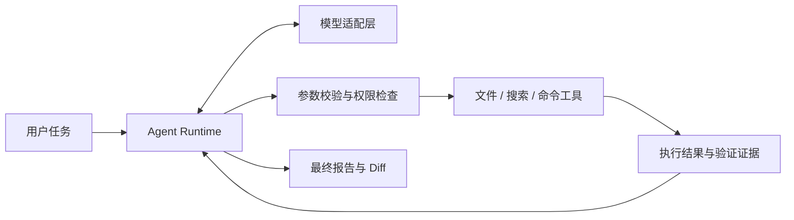

<div align="center">

# Mini Coding Agent

**从一次模型调用，到可验证的代码修改闭环。**

用 Python 亲手构建一个面向本地代码仓库的个人 Coding Agent。


[项目介绍](#about) · [设计重点](#design) · [快速开始](#quick-start) · [开发路线](#roadmap) · [设计文档](DESIGN.md)

</div>

> **开发状态：M0 · 环境与协议实验**
>
> 当前已完成 Python 包与 CLI 入口的初始化，运行后输出问候语。配置加载、模型接入、工具调用和 Agent Loop 尚未实现。下文的架构与能力描述为设计目标，具体进度见开发路线。

<a id="about"></a>

## 为什么做这个项目

一个 Coding Agent，需要把用户需求变成一系列真实行动：理解代码、选择工具、修改文件、运行检查，再根据结果继续推进。

这个项目希望把其中的机制逐步实现并解释清楚：模型如何请求工具，程序如何校验和执行，结果如何回到下一轮请求，以及一次任务凭什么被判定为完成。

技术主线采用 **Python + OpenAI Python SDK + DeepSeek**，自行实现单 Agent 运行循环。开发从小型 Python 练习仓库开始，逐步补齐变更保护、上下文管理和中断恢复，最终形成可用于个人项目的本地 CLI。

<a id="design"></a>

## 设计重点

以下是项目计划逐步实现的能力。

| 方向 | 关注的问题 | 设计目标 |
| :--- | :--- | :--- |
| **Agent Loop** | 一次需求如何推进为多轮行动？ | 明确消息流、工具批次、调用预算与停止条件 |
| **工具协议** | 模型生成参数后，程序应做什么？ | 分开参数校验、权限判断、实际执行与结果反馈 |
| **文件编辑** | 如何保护用户和 IDE 的并发修改？ | 基于已读取版本编辑，冲突时拒绝覆盖，保留可审阅 Diff |
| **执行与验证** | 命令退出后，怎样判断任务完成？ | 记录退出码、输出和验证证据，让结论关联实际代码状态 |
| **上下文与恢复** | 长任务或中断后，如何继续？ | 保留协议完整性，核对真实状态，避免盲目重放副作用 |

### 目标工作流



模型提出下一步行动，程序负责执行约束；工具结果成为下一轮请求的输入，最终报告依据真实的修改与验证记录生成。

### 平台策略

优先在 **Windows 原生环境**中开发与验收。模型调用、文件操作和运行循环使用公共核心，命令执行等系统差异逐步收敛到适配层。

WSL2 / Linux 是可选运行环境；Docker 是后续按需启用的隔离后端。二者均不作为 Windows 核心功能的默认前置依赖。各平台能力以实际验收结果为准。

<a id="quick-start"></a>

## 快速开始

以下步骤用于运行**当前的初始化入口**。请先准备 Git 与 uv，在 Windows PowerShell 中执行：

```powershell
git clone https://github.com/LambdaOvO/mini-coding-agent.git
cd mini-coding-agent
uv sync
uv run mini-coding-agent
```

预期输出：

```text
Hello from mini-coding-agent!
```

项目以 Python 3.12 为初始基线，通过 `pyproject.toml` 和 `uv.lock` 管理依赖。当前入口无需模型密钥；模型接入完成后，将补充凭据配置和问答示例。

<a id="roadmap"></a>

## 开发路线

每个阶段都按「理解原理 → 亲自编码 → 本地验证 → 代码审查」推进。

| 阶段 | 目标 | 状态 |
| :--- | :--- | :--- |
| **M0 · 环境与协议实验** | 配置加载、普通模型调用、计算工具往返、消息序列化 | **进行中：包与入口已初始化** |
| **M1 · 只读 Agent** | 自主循环、工具注册、文件读取与检索、路径门禁 | 计划中 |
| **M2 · 修改与验证闭环** | 精确编辑、受控命令、Diff 与基础验证记录 | 计划中 |
| **M3 · 个人项目能力** | 变更保护、范围授权、计划与跨文件任务 | 计划中 |
| **M4–M5 · 会话与上下文** | 持久化、状态恢复、上下文预算与压缩 | 计划中 |
| **M6–M7 · 运行可靠性** | 中断核对、有界重试、平台执行适配与可选隔离 | 计划中 |
| **M8 · 验收与交付** | 固定评测、安装说明、使用文档与代表任务演示 | 计划中 |
| **M9 · 按需扩展** | 根据实际问题评估 LSP、MCP、多模型等能力 | 可选 |

首个完整闭环的目标：在开发者准备的练习仓库中，完成一次「测试失败 → 读取代码 → 精确修改 → 重新验证 → 报告结果」。

## 当前目录

```text
mini-coding-agent/
├── src/
│   └── mini_coding_agent/
│       └── __init__.py     # 当前 CLI 入口
├── .gitignore
├── .python-version        # Python 3.12 基线
├── DESIGN.md              # 架构、接口、阶段与导师协作约定
├── pyproject.toml         # 项目元数据、依赖与命令入口
├── README.md
└── uv.lock                # 依赖锁文件
```

只在推进到相应阶段时添加所需模块，目录随实际能力演进。

## 开发方式

核心代码由开发者亲自编写、运行和修改。AI 作为导师与代码审查者，协助解释原理、拆分小目标、分析问题和设计验收方法。

[DESIGN.md](DESIGN.md) 是本项目的统一设计依据，包含模块职责、接口建议、M0–M9 实施顺序与协作约定。README 随实际进度更新，已实现功能与设计目标分别说明。
